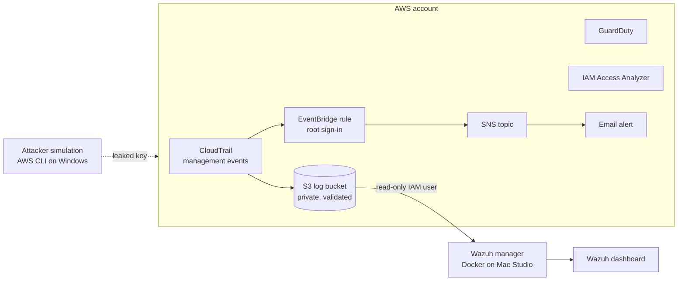

# AWS Cloud Security Lab

A hands-on lab where I secured a personal AWS account, turned on AWS's core detection services, broke things on purpose, caught them, fixed them, and wired CloudTrail into my self-hosted Wazuh SIEM.

This is the third lab in my security engineering series. It builds on my [Home SIEM Lab (Wazuh)](#) and my AWS Certified Cloud Practitioner cert.

## Why I built this

My day job is physical security technology: cameras, access control, and the platforms behind them across offices globally. More and more of that stack runs in the cloud. Access control is cloud-managed, and our device-health platform runs on AWS EC2. Securing physical security systems now means knowing how to secure the cloud they sit on, so I wanted real hands-on time with AWS detection and response.

## Architecture



## Tools

- AWS: IAM, IAM Identity Center, CloudTrail, GuardDuty, IAM Access Analyzer, S3, EventBridge, SNS, AWS Budgets
- AWS CLI (attacker simulation)
- Wazuh 4.14 (single-node Docker) with the aws-s3 module

## Phase 0: Account baseline

- Confirmed MFA on the root user, then stopped using root for daily work
- Reviewed an admin IAM user that had been idle for 310 days: no access keys, but no MFA, so I added MFA
- Budget alert in place to catch surprise charges
- Picked one working region (us-east-2) and tagged every resource `Project = AWS Security Lab` for clean teardown

## Phase 1: Logging with CloudTrail

- Created a management-events trail delivering to a private S3 bucket with log file validation on
- Verified events in Event history: my root sign-in, my IAM user sign-in, and the trail creation itself

**Triage moment:** an unfamiliar username, `onboarding`, appeared calling `CreateView`. The event source was `resource-explorer.amazonaws.com`, which means AWS set up Resource Explorer automatically. That makes it a service, not a person. Checking the event source before escalating is the first habit of good triage.

## Phase 2: Threat detection with GuardDuty

Enabled GuardDuty, generated sample findings, and wrote SOC-style triage notes for three high-severity findings:

| Finding | What it means | Response |
|---|---|---|
| Kubernetes API used in impact tactics, invoked by anonymous user | EKS API accepting unauthenticated calls that can delete or change workloads | Disable anonymous access, restrict the API endpoint, review audit logs for changes |
| EC2 instance behaving like a DDoS source (UDP) | Outbound attack traffic from my instance, so it's likely compromised | Isolate with a deny-all security group and snapshot the disk **before** shutting down, to keep evidence; investigate and rebuild from a clean image |
| Security-sensitive file read in an EKS cluster | A process read a credential or token file inside a container | Identify the file, escalate, rotate exposed credentials, isolate the pod, search CloudTrail for use of those credentials, fix the root cause |

My triage checklist for any finding: overview and first/last seen, affected resource, the attached IAM role (what an attacker could reach from it), network exposure, the action taken, and where the traffic went.

## Phase 3: Break it, catch it, fix it

### 1. Public S3 bucket

- **Break:** turned off Block Public Access on a test bucket and added a bucket policy allowing `s3:GetObject` to `*`. A harmless `hello.txt` was readable from a private browser window.
- **Catch:** IAM Access Analyzer flagged the bucket as publicly accessible through the bucket policy.
- **Fix:** deleted the policy and re-enabled Block Public Access.
- **Verify:** the same URL returned `Access Denied`.

### 2. Overly permissive IAM policy

- **Break:** wrote a policy granting `s3:*` and `iam:PassRole` on `*`.
- **Catch:** Access Analyzer policy validation warned about `PassRole` with a wildcard resource, a known privilege-escalation path.
- **Fix:** replaced it with least privilege: `s3:GetObject` and `s3:ListBucket` on one bucket only.

**Real bug along the way:** a typo in the bucket ARN quietly broke access (`NoSuchBucket`). Small policy mistakes either over-grant or silently fail, so test policies after you write them.

### 3. Leaked access key

- **Break:** created an access key for a low-privilege test user and used it from the AWS CLI as an "attacker."
  - `sts get-caller-identity` worked, which is how an attacker learns whose key they found
  - Listing the one allowed bucket worked
  - `iam list-users` failed with AccessDenied, because least privilege contained the blast radius
- **Catch:** traced the activity in CloudTrail by filtering on the access key ID.
- **Fix:** deactivated, then deleted the key.
- **Verify:** the CLI now returns `InvalidClientTokenId`.

**Lesson:** S3 object reads and downloads are *data events*, which a default management-events trail does not log. An attacker with this key could have downloaded the file and CloudTrail would not have shown it. Catching that needs S3 data event logging or GuardDuty S3 Protection. Least privilege limited the damage, but visibility has to be designed in.

### 4. Root sign-in alert

- Built an EventBridge rule matching `AWS Console Sign In via CloudTrail` where `userIdentity.type = Root`, targeting an SNS email topic.
- **Gotcha:** console sign-in events land in **us-east-1**, so the rule and topic had to live there, not in my working region.
- **Verify:** signing in as root produced an email alert within minutes, including the source IP.

Event pattern:

```json
{
  "detail-type": ["AWS Console Sign In via CloudTrail"],
  "detail": {
    "userIdentity": {
      "type": ["Root"]
    }
  }
}
```

## Phase 4: CloudTrail into Wazuh

- Created a dedicated `wazuh-reader` IAM user with read-only access to the CloudTrail bucket only
- Configured the Wazuh aws-s3 module to pull CloudTrail from both us-east-1 and us-east-2:

```xml
<wodle name="aws-s3">
  <disabled>no</disabled>
  <interval>10m</interval>
  <run_on_start>yes</run_on_start>
  <skip_on_error>yes</skip_on_error>
  <bucket type="cloudtrail">
    <name><CLOUDTRAIL_BUCKET></name>
    <aws_profile>wazuh</aws_profile>
    <regions>us-east-1,us-east-2</regions>
  </bucket>
</wodle>
```

**Troubleshooting log:**

- The module produced no log output at all. Checking the container's live `ossec.conf` showed the config had never loaded.
- Docker Desktop's Bind mounts tab showed which host file is mounted into the container (`config/wazuh_cluster/wazuh_manager.conf`). The edit had to go there.
- Restarting the Wazuh service from the dashboard doesn't reload that file. The **container** has to be restarted, because the mounted config is copied in at container start.
- Also found the dashboard still on its default admin password and changed it. Default credentials are one of the first things attackers try.

## Teardown

Every resource carried the `Project = AWS Security Lab` tag, so cleanup started from a tag search. GuardDuty, the trail, both buckets, the SNS topic and EventBridge rule, the Access Analyzer, and the test IAM users and policies were all removed, followed by a billing check the next day.

## What I'd do next

- Write custom Wazuh rules for `StopLogging` / `DeleteTrail` (an attacker covering their tracks) and console logins without MFA
- Turn on S3 data events for sensitive buckets to close the download-visibility gap
- Rebuild the account baseline with Terraform
- Add a small boto3 script that flags IAM users without MFA and access keys older than 90 days

## Key takeaways

1. Least privilege doesn't stop a leak, but it decides how bad the leak is.
2. Default logging has blind spots. Know which events you aren't collecting.
3. Region matters: global services like IAM and console sign-in log to us-east-1.
4. Triage starts with "is this a person or a service?"
5. Contain before you shut down, so you don't destroy evidence.

*All account IDs, IPs, bucket names, and keys in this repo are placeholders. Screenshots are redacted.*
